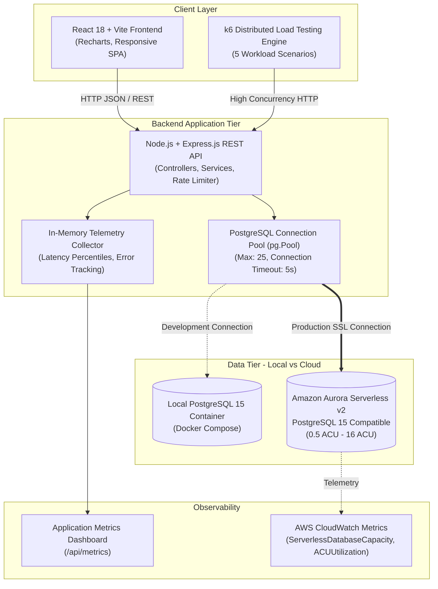
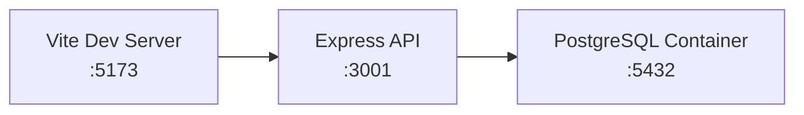
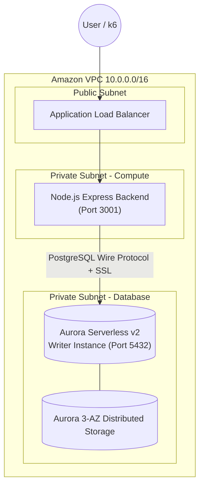

# System Architecture Document

## 1. High-Level Architectural Overview

The **Student Admissions Portal** is designed specifically to study and evaluate the scaling dynamics, latency characteristics, and cost trade-offs of **Amazon Aurora PostgreSQL Serverless v2** under highly variable, seasonal academic workloads.

---

## 2. Component Descriptions

| Layer | Technology | Key Responsibilities |
| :--- | :--- | :--- |
| **Frontend** | React 18, Vite, Recharts, React Router v6 | Responsive dashboard, multi-step application registration, real-time application-level telemetry graphs, and status review interface. |
| **Backend API** | Node.js (ESM), Express.js | Exposes standardized REST endpoints (`/api/students`, `/api/applications`, `/api/health`, `/api/metrics`). Executes business transactions and parameterized queries. |
| **Connection Pooling** | `pg.Pool` | Manages warm database sockets, multiplexing concurrent HTTP requests across database connections without handshaking latency. |
| **Database Tier** | Amazon Aurora PostgreSQL Serverless v2 | Scales compute capacity in fractions of 0.5 ACU (approx. 2 GiB RAM per ACU) based on workload pressure. |
| **Load Generator** | k6 | Generates realistic admissions traffic patterns (baseline, sudden deadline surges, sustained peaks, recovery cooldowns). |
| **Monitoring** | Dual Monitoring (Application + AWS CloudWatch) | Node.js captures client-perceived latency (P50, P95, P99); CloudWatch captures database internals (`ServerlessDatabaseCapacity`, `CPUUtilization`). |

---

## 3. Deployment Topologies

### Topology A: Local Development Environment
In local development, the Node.js API connects to a PostgreSQL 15 container orchestrated via `docker-compose.yml`. Schema creation and course seeding happen automatically on initialization via `/docker-entrypoint-initdb.d/`.

### Topology B: AWS Cloud Deployment
In AWS, the Node.js backend can run on an EC2 instance or ECS Fargate task within a private VPC subnet. It connects securely over SSL to the Aurora Serverless v2 Cluster Writer Endpoint.

---

## 4. Connection Pooling Mechanics & High Concurrency

When variable traffic spikes hit the API:
1. **Socket Pre-Allocation**: Opening an SSL TCP handshake to Aurora takes 40–120ms. The `pg.Pool` maintains warm connections to eliminate this handshake penalty during requests.
2. **Backpressure Handling**: Under severe spikes, if all connections in `DB_POOL_MAX` are occupied, subsequent requests wait in an internal FIFO queue up to `DB_CONNECTION_TIMEOUT` (5000ms).
3. **Graceful Degradation**: If queries exceed `DB_QUERY_TIMEOUT` (30000ms), the connection is terminated and an HTTP 504 Gateway Timeout is returned, protecting both the backend and database from cascading failures.

---

## 5. Aurora Serverless v2 Auto-Scaling Dynamics & The Scaling Lag Problem

### How Aurora Auto-Scales
Aurora Serverless v2 monitors database engine activity (active sessions, transaction commits, CPU, buffer pool consumption) every second.
- When utilization thresholds are crossed, Aurora scales compute capacity **in-place** without dropping client connections or interrupting transactions.
- Scaling occurs in fine-grained increments of 0.5 ACU.

### The Scaling Lag Bottleneck (Project Focus)
When traffic surges from 5 VUs to 100 VUs in under 10 seconds (such as a midnight admission deadline):
1. **Measurement Interval**: Aurora's scaling algorithm observes sustained load for approximately 10 to 15 seconds to ensure the spike is not transient noise.
2. **Allocation Time**: Expanding memory buffers and CPU allocation takes a brief period.
3. **Scaling Lag**: During this 15–30 second window, the database operates at low capacity (e.g. 0.5 ACU). Queries queue up, latency spikes, and if connection timeouts occur, HTTP 504s may be returned to applicants.
4. **Resolution**: Once Aurora reaches the required capacity (e.g. 4–8 ACUs), latency drops back to baseline and queue backlog clears.

This project empirically demonstrates this phenomenon and tests mitigation strategies (such as elevating Minimum ACU).
