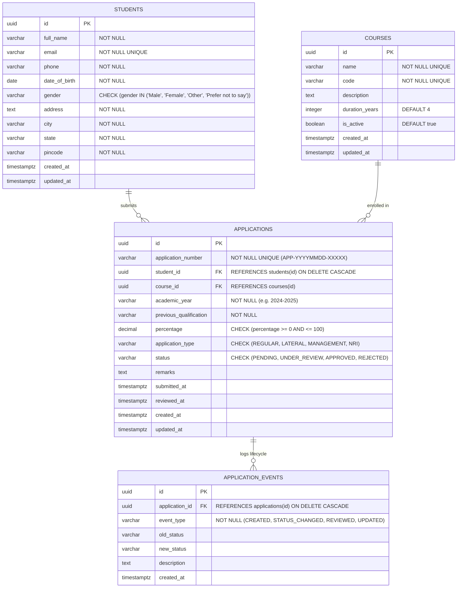

# Database Architecture & Design Document

This document details the PostgreSQL schema designed specifically for **Amazon Aurora PostgreSQL Serverless v2** and local PostgreSQL development.

---

## 1. Entity-Relationship (ER) Diagram



---

## 2. Table Specifications

### A. `courses`
Stores the academic degree programs offered by the institution.
- **Primary Key**: `id UUID DEFAULT gen_random_uuid()`
- **Natural Key**: `code VARCHAR(20) UNIQUE` (e.g. `CSE`, `AIML`, `ECE`)
- **Lifecycle**: Maintained by academic administrators; referenced by applications.

### B. `students`
Stores prospective students who register on the admissions portal.
- **Primary Key**: `id UUID DEFAULT gen_random_uuid()`
- **Unique Constraint**: `email UNIQUE` prevents duplicate registrations.
- **Validation Constraints**: `gender` check constraint enforces demographic data consistency.

### C. `applications`
Core transactional table storing admission submissions.
- **Primary Key**: `id UUID DEFAULT gen_random_uuid()`
- **Human Reference**: `application_number UNIQUE` generated as `APP-YYYYMMDD-XXXXX` for applicant tracking.
- **Foreign Keys**: 
  - `student_id` &rarr; `students(id)` with `ON DELETE CASCADE`.
  - `course_id` &rarr; `courses(id)` restricting invalid courses.
- **Business Constraints**:
  - `percentage`: Validated between 0.00 and 100.00.
  - `application_type`: Must be one of `REGULAR`, `LATERAL`, `MANAGEMENT`, `NRI`.
  - `status`: Lifecycle transitions through `PENDING` &rarr; `UNDER_REVIEW` &rarr; `APPROVED` or `REJECTED`.

### D. `application_events`
Immutable audit log tracking every submission and status transition.
- **Primary Key**: `id UUID DEFAULT gen_random_uuid()`
- **Foreign Key**: `application_id` &rarr; `applications(id)` with `ON DELETE CASCADE`.
- **Purpose**: Enables audit compliance, timeline visualization in UI, and historical latency analysis.

---

## 3. Database Indexes & Query Rationale

Every index in `database/schema.sql` was specifically created to optimize high-concurrency admission workloads:

| Index Name | Target Column(s) | Architectural Rationale |
| :--- | :--- | :--- |
| `idx_students_email` | `students(email)` | **Fast duplicate checks and lookups**: During peak registration surges, every `POST /api/students` checks for existing emails. B-Tree index keeps check to $O(\log N)$. |
| `idx_students_city` | `students(city)` | **Regional analytics**: Supports analytical aggregations and regional quota queries without full-table scans. |
| `idx_students_created_at` | `students(created_at DESC)` | **Chronological student listing**: Speeds up pagination in the administration portal (`ORDER BY created_at DESC LIMIT 15 OFFSET 0`). |
| `idx_applications_student_id` | `applications(student_id)` | **Foreign key join acceleration**: Prevents sequential table scans when joining `applications` with `students` on student detail views and profile queries. |
| `idx_applications_course_id` | `applications(course_id)` | **Course filtering & quota checks**: Accelerates queries filtering applications by academic program (e.g. `WHERE course_id = $1`). |
| `idx_applications_status` | `applications(status)` | **Workflow queue filtering**: The admissions committee constantly queries `WHERE status = 'PENDING'` or `'UNDER_REVIEW'`. Crucial index for dashboard metrics. |
| `idx_applications_academic_year` | `applications(academic_year)` | **Cohort partitioning & filtering**: Segregates historical cohorts from the current active admissions cycle. |
| `idx_applications_submitted_at` | `applications(submitted_at DESC)` | **Submission ordering & SLA metrics**: Essential for FIFO application processing and timeline analysis. |
| `idx_applications_number` | `applications(application_number)` | **Applicant lookup**: Direct index scan when an applicant or officer searches for a specific application reference. |
| `idx_application_events_application_id` | `application_events(application_id)` | **Audit trail retrieval**: Used when opening an application detail modal to fetch associated timeline events without scanning the entire events table. |
| `idx_application_events_created_at` | `application_events(created_at DESC)` | **Global activity feed**: Speeds up queries retrieving the most recent system activity. |

---

## 4. Triggers & Automation

The schema attaches an `update_updated_at_column()` trigger to `courses`, `students`, and `applications`:
```sql
CREATE OR REPLACE FUNCTION update_updated_at_column()
RETURNS TRIGGER AS $$
BEGIN
    NEW.updated_at = NOW();
    RETURN NEW;
END;
$$ language 'plpgsql';
```
This guarantees that whenever an application status is modified or a student profile is edited, the `updated_at` column is automatically stamped with the exact transaction timestamp.

---

## 5. Amazon Aurora Serverless v2 Optimization Notes

1. **UUID Keys**: Using `gen_random_uuid()` (via `pgcrypto`) distributes insert write operations evenly across Aurora storage pages, preventing hotspotting on index B-Trees that can occur with auto-incrementing serial IDs under heavy distributed write loads.
2. **Prepared Statements**: Parameterized queries ($1, $2) allow PostgreSQL query planner to reuse execution plans, minimizing CPU utilization during rapid traffic spikes.
3. **Connection Pooling**: Node.js `pg.Pool` maintains idle connections ready for immediate reuse, avoiding the high latency overhead of establishing SSL handshakes for every incoming HTTP request.
