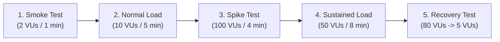

# Comprehensive k6 Load Testing Guide

This guide details how to install, configure, and execute the 5 distinct k6 load-testing scenarios designed to analyze the auto-scaling behavior, latency, and scaling lag of **Amazon Aurora PostgreSQL Serverless v2**.

---

## 1. Installing k6

### Windows
- **Using Chocolatey**:
  ```powershell
  choco install k6
  ```
- **Using Winget**:
  ```powershell
  winget install k6 --source winget
  ```
- **Direct Installer**: Download the official Windows `.msi` from [k6 Releases](https://github.com/grafana/k6/releases).

### macOS
```bash
brew install k6
```

### Linux (Debian / Ubuntu)
```bash
sudo gpg -k
sudo gpg --no-default-keyring --keyring /usr/share/keyrings/k6-archive-keyring.gpg --keyserver hkp://keyserver.ubuntu.com:80 --recv-keys C5AD17C747E3415A3642D57D77C6C491D6AC1D69
echo "deb [signed-by=/usr/share/keyrings/k6-archive-keyring.gpg] https://dl.k6.io/deb stable main" | sudo tee /etc/apt/sources.list.d/k6.list
sudo apt-get update
sudo apt-get install k6
```

Verify installation:
```bash
k6 version
```

---

## 2. Configuration & Environment Variables

All scripts import shared configuration from `load-tests/config.js`. Parameters can be customized via environment variables:

| Environment Variable | Default | Purpose |
| :--- | :--- | :--- |
| `BASE_URL` | `http://localhost:3001` | Target backend host and port |
| `VUS` | `10` | Number of concurrent virtual users |
| `DURATION` | `30s` | Duration override for quick smoke runs |

**Example of overriding parameters**:
```bash
# Run against a remote backend
k6 run -e BASE_URL=https://api.yourdomain.com load-tests/smoke.js

# Run with customized concurrency
k6 run -e VUS=25 -e DURATION=1m load-tests/smoke.js
```

---

## 3. Workload Scenarios



### Scenario 1: Smoke Verification (`load-tests/smoke.js`)
- **Purpose**: Fast smoke check to verify endpoint reachability, database connectivity, and error handling before running heavy load.
- **Traffic**: 2 VUs for 1 minute.
- **Mix**: Health check (`/api/health`), student listing (`/api/students`), and statistics aggregation (`/api/applications/stats`).
- **Pass Criteria**: P95 Latency < 500ms, Error Rate < 1%.
- **Command**:
  ```bash
  k6 run load-tests/smoke.js
  ```

---

### Scenario 2: Normal Admissions Workload (`load-tests/normal-load.js`)
- **Purpose**: Simulates routine daytime portal activity outside of deadlines.
- **Traffic**: Ramp up to 10 VUs over 1m &rarr; maintain 10 VUs for 3m &rarr; ramp down to 0 over 1m.
- **Mix**:
  - 40% Browse applications (`GET /api/applications`)
  - 20% Browse registered students (`GET /api/students`)
  - 15% Register new student profile (`POST /api/students`)
  - 15% Complete application submission (`POST /api/applications`)
  - 5% Admissions dashboard metrics (`GET /api/applications/stats`)
  - 5% Health & telemetry checks (`GET /api/metrics`)
- **Pass Criteria**: P95 Latency < 1000ms, P99 Latency < 2000ms, Error Rate < 5%.
- **Command**:
  ```bash
  k6 run load-tests/normal-load.js
  ```

---

### Scenario 3: Admission Deadline Rush / Spike Test (`load-tests/spike-test.js`)
- **Purpose**: **Primary Academic Experiment**: Simulates a sudden, massive rush of students submitting applications right before midnight on the final admission deadline.
- **Traffic Profile**:
  - 0s &rarr; 30s: 5 VUs (normal baseline)
  - 30s &rarr; 1m30s: 5 VUs (steady baseline)
  - **1m30s &rarr; 1m40s: SURGE to 100 VUs in 10 seconds!**
  - 1m40s &rarr; 3m40s: Hold 100 VUs (sustained deadline surge)
  - 3m40s &rarr; 4m10s: Ramp down to 5 VUs (deadline closes)
  - 4m10s &rarr; 5m10s: Hold 5 VUs (cooldown observation)
- **Mix**: Heavy write load (40% Student Registration + 40% Application Submission + 20% Dashboard checks).
- **Phenomenon to Observe**:
  - Notice the **scaling lag** in the first 15–30 seconds of the 100 VU surge.
  - Watch for elevated P99 latency and potential 504 timeouts while Aurora adjusts its ACU capacity from 0.5 up to 4–8 ACUs.
- **Command**:
  ```bash
  k6 run load-tests/spike-test.js
  ```

---

### Scenario 4: Sustained Peak Period (`load-tests/sustained-load.js`)
- **Purpose**: Simulates an intense multi-day admissions release period where traffic remains high for an extended duration.
- **Traffic**: Ramp to 50 VUs over 2m &rarr; Hold 50 VUs for 5 minutes &rarr; Ramp down over 1m.
- **Mix**: Balanced mix of reads, writes, and heavy statistical aggregation queries.
- **Phenomenon to Observe**: Confirms whether Aurora stabilizes at higher ACUs and maintains low query latencies once scaled.
- **Command**:
  ```bash
  k6 run load-tests/sustained-load.js
  ```

---

### Scenario 5: Rapid Recovery & Scale-Down (`load-tests/recovery-test.js`)
- **Purpose**: Tests system recovery after load drops precipitously.
- **Traffic**: Ramp to 80 VUs over 1m &rarr; Hold 80 VUs for 3m &rarr; **Drop to 5 VUs in 10 seconds** &rarr; Hold 5 VUs for 3m.
- **Phenomenon to Observe**:
  - Measures how quickly API latency returns to baseline.
  - Measures how long Aurora Serverless v2 takes to safely decrement ACU capacity back toward minimum ACU to save costs.
- **Command**:
  ```bash
  k6 run load-tests/recovery-test.js
  ```

---

## 4. Understanding & Interpreting k6 Output Metrics

At the end of each test run, k6 displays a terminal summary:

```text
✓ health check 200 ............: 100.00% ✓ 450    ✗ 0
✓ submit application 201 ......: 98.40%  ✓ 1230   ✗ 20

checks ........................: 99.10%  ✓ 3200   ✗ 29
error_rate ....................: 0.90%   ✓ 29     ✗ 3200
http_req_duration .............: avg=42.3ms min=8.2ms med=24.1ms max=1820ms p(90)=82ms p(95)=195ms p(99)=620ms
http_req_failed ...............: 0.90%   ✓ 29     ✗ 3200
http_reqs .....................: 3229    53.8/s
request_duration ..............: avg=42.3ms min=8.2ms med=24.1ms max=1820ms p(95)=195ms
timeout_rate ..................: 0.20%   ✓ 6      ✗ 3223
vus ...........................: 5       min=5    max=100
```

### Key Metrics to Record for Academic Evaluation:
1. **`http_req_duration` `p(95)` and `p(99)`**: Shows the 95th and 99th percentile response time. If P99 is significantly higher than median (`med`), it indicates queueing delays during scaling lag.
2. **`timeout_rate` / `http_req_failed`**: Demonstrates whether requests dropped or timed out before Aurora completed ACU expansion.
3. **`http_reqs` (Throughput in req/s)**: Total request throughput sustained by the architecture.
